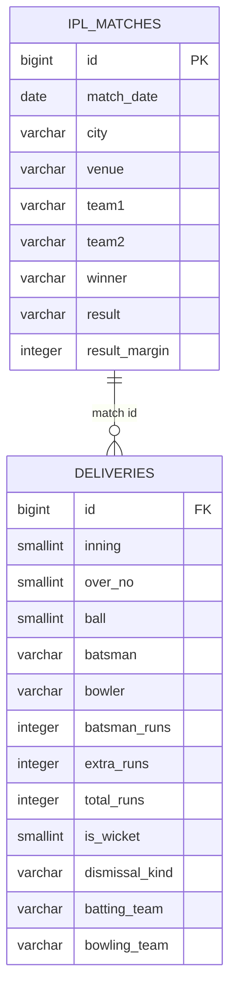

# IPL Match & Ball-by-Ball Performance Analysis

**SQL portfolio project | PostgreSQL | Match analytics | Delivery-level analysis | Data quality**

An end-to-end SQL analysis of Indian Premier League (IPL) match results and ball-by-ball performance from **2008 to 2020**. The project combines match-level and delivery-level datasets to examine scoring patterns, team performance, bowling discipline, venue characteristics, and data consistency.

> **Project structure:** This README follows a CRISP-DM-inspired analytics narrative: Business Understanding → Data Understanding → Data Preparation → Analysis → Findings & Business Implications → Reproducibility.

## 1. Business understanding

### Business problem

A cricket analytics team needs a consistent way to explore match outcomes and delivery-level performance across seasons. Match summaries alone cannot explain how teams score, how bowlers build pressure, or how scoring varies by venue.

This project uses SQL to connect match context with individual delivery records and answer practical questions for:

- **Team strategy:** Which batting sides generate more high-scoring deliveries, and which bowling sides create more dot-ball pressure?
- **Bowling review:** Which bowlers concede the most extra runs, and what dismissal types occur most often?
- **Venue analysis:** Which grounds record the highest aggregate runs, and how does scoring at Eden Gardens vary by year?
- **Tournament reporting:** How many cities and venues have hosted matches, and how often do ties or large run-margin wins occur?
- **Data reliability:** Are delivery identifiers unique, and are team names standardized before aggregation?

### Project objectives

1. Explore match outcomes and tournament coverage.
2. Measure scoring and bowling patterns using delivery-level data.
3. Compare aggregate scoring by venue and season.
4. standardize inconsistent team labels.
5. Detect repeated delivery keys before relying on delivery-level metrics.

## 2. Data understanding

The repository contains two related CSV datasets.

| Dataset | Records | Columns | Grain | Role |
|---|---:|---:|---|---|
| `IPL_matches.csv` | 816 | 17 | One row per match | Match date, venue, teams, toss, winner, result, margin and umpires |
| `IPL_Ball.csv` | 193,468 | 17 | One row per delivery | Innings, over, ball, batter, bowler, runs, extras, wicket and team details |

**Coverage:** 816 distinct matches, 193,468 delivery records, 33 cities and 36 venues across 13 seasons (2008–2020).

### Data model



The common match identifier is `id`. It repeats in the delivery table because a match contains many deliveries; therefore, it must not be treated as a unique delivery identifier.

## 3. Data preparation and quality

The original project creates match and delivery tables, imports the CSV files, derives delivery classifications, enriches delivery rows with venue/date information, standardizes a team name, and checks delivery keys.

The audit of the supplied files identified these important points:

- The match CSV has **816 unique match IDs**.
- The delivery CSV has **193,468 rows** and **193,458 distinct** `match_id + inning + over + ball` combinations.
- There are **10 repeated delivery keys** (10 additional rows beyond the distinct-key count).
- The original delivery-table DDL briefly declared `id` as a primary key even though it is a match ID repeated across deliveries, then dropped that constraint.
- The original import section renames `IPL_BALL` to `deliveries` and subsequently tries to import into `IPL_BALL`; that target table no longer exists after the rename.
- The original `COPY` statements use machine-specific Windows paths and have their match/delivery import comments and targets mixed up.
- The original delivery key comment specifies hyphens, while the original SQL used commas.

A corrected companion script is provided as **[`add_IPL_MATCHES.sql`](add_IPL_MATCHES.sql)**. It corrects the table design and import sequence, uses relative CSV paths with psql `\copy`, uses a consistent hyphen-separated delivery key, and preserves the original analytical questions. The original `IPL_MATCHES.sql` and `QUERY.txt` are left unchanged; they contain the same SQL workflow.

## 4. Analysis performed

### A. Match outcomes and tournament footprint

Original questions include:

- Matches played on 2 May 2013.
- Matches won by more than 100 runs when the result is runs.
- Tied matches, sorted by date.
- Number of distinct cities that have hosted an IPL match.

### B. Batting and bowling performance

Original questions include:

- Total boundary-classified deliveries and dot balls.
- Boundary-classified deliveries by batting team.
- Dot balls by bowling team.
- Dismissal counts by dismissal type.
- Top five bowlers by extra runs conceded.

The original classification is retained in the corrected script:

- `total_runs >= 4` → `boundary`
- `total_runs = 0` → `dot`
- Otherwise → `other`

**Important metric definition:** The original boundary rule uses total delivery runs. It is therefore a *boundary proxy*, not an exact count of batter-hit fours and sixes. For a batter-hit boundary measure, use `batsman_runs >= 4`.

### C. Venue and season analysis

Original questions include:

- Total runs scored at each venue.
- Year-wise total runs scored at Eden Gardens.

### D. Team-name standardization

The project creates corrected team-name columns to consolidate `Rising Pune Supergiants` into `Rising Pune Supergiant`, so the same franchise is not split across two labels in grouped reports.

### E. Delivery-key quality checks

The project builds a delivery key from match ID, innings, over and ball, compares total rows with distinct keys, uses `ROW_NUMBER()` to identify repeated keys, and uses a subquery to return all rows associated with repeated keys.

## 5. Quantitative findings

The following figures were calculated directly from the committed CSV datasets using the same definitions as the original analysis. They are descriptive results from this dataset, not claims of a separately executed PostgreSQL session.

### Match-level findings

| KPI | Result |
|---|---:|
| Matches | 816 |
| Cities | 33 |
| Venues | 36 |
| Tied matches | 13 |
| Matches won by more than 100 runs (result = runs) | 9 |
| Matches dated 2 May 2013 | 2 |

### Delivery-level findings

| KPI | Result |
|---|---:|
| Delivery records | 193,468 |
| Total runs | 252,794 |
| Extra runs | 12,849 |
| Dot-ball records (`total_runs = 0`) | 67,841 |
| Boundary proxy (`total_runs >= 4`) | 31,468 |
| Batter-hit boundary records (`batsman_runs >= 4`) | 30,870 |
| Distinct delivery keys | 193,458 |
| Repeated delivery keys | 10 |

The difference between the two boundary measures is **598 deliveries**. This is why the README distinguishes the original total-runs proxy from batter-hit boundaries.

### Teams with the most boundary-proxy deliveries

| Batting team | Delivery count |
|---|---:|
| Mumbai Indians | 4,118 |
| Royal Challengers Bangalore | 3,800 |
| Kings XI Punjab | 3,780 |
| Kolkata Knight Riders | 3,739 |
| Chennai Super Kings | 3,496 |

### Teams with the most dot balls

| Bowling team | Dot-ball count |
|---|---:|
| Mumbai Indians | 8,714 |
| Royal Challengers Bangalore | 7,955 |
| Kolkata Knight Riders | 7,894 |
| Kings XI Punjab | 7,679 |
| Chennai Super Kings | 7,593 |

### Bowlers conceding the most extra runs

| Bowler | Extra runs conceded |
|---|---:|
| SL Malinga | 293 |
| P Kumar | 236 |
| UT Yadav | 226 |
| DJ Bravo | 210 |
| B Kumar | 201 |

### Venue scoring

| Venue | Total runs |
|---|---:|
| Eden Gardens | 23,658 |
| Wankhede Stadium | 23,390 |
| Feroz Shah Kotla | 22,947 |

At Eden Gardens, **2018** has the highest year-wise total in the supplied data, with **2,885 runs**.

### Dismissal pattern

Caught dismissals are the most frequent dismissal type in the dataset, with **5,743 records**.

## 6. Business interpretation

- **Batting output:** Mumbai Indians lead the original boundary-proxy count (4,118). This indicates the highest count under the project's `total_runs >= 4` definition; it should not be interpreted as an exact fours-and-sixes leaderboard.
- **Bowling pressure:** Mumbai Indians also record the most dot-ball deliveries (8,714) under the original definition. Dot-ball counts are a useful pressure indicator, but they should be compared with overs bowled or innings context for a fair efficiency measure.
- **Bowling discipline:** SL Malinga has the highest aggregate extra runs conceded in the dataset (293). This is a descriptive total and is not adjusted for matches or deliveries bowled.
- **Ground context:** Eden Gardens has the highest aggregate runs (23,658) among the listed venues. A deeper venue comparison should normalize by matches played at each ground.
- **Data trust:** The 10 repeated delivery keys show why record-level validation matters before building player or team KPIs.

## 7. SQL skills demonstrated

- Relational table design and data types
- CSV ingestion and null handling
- Filtering, sorting and limiting
- Aggregations: `COUNT`, `SUM`, `GROUP BY`
- Conditional logic with `CASE`
- Joins between match and delivery data
- Date functions and year extraction
- Data standardization
- Window functions: `ROW_NUMBER()`
- Subqueries and duplicate-key analysis

## 8. How to run

### Recommended: corrected companion script

Requirements: PostgreSQL and the `psql` command-line client.

1. Clone or download this repository.
2. Open a terminal in the repository root (the folder containing both CSV files).
3. Create an empty PostgreSQL database.
4. Run:

```bash
psql -d your_database_name -f add_IPL_MATCHES.sql
```

The companion script uses psql's `\copy` command and expects `IPL_matches.csv` and `IPL_Ball.csv` in the current working directory. Run it once in a fresh database. If using pgAdmin, import the CSVs with its Import/Export tool and execute the SQL sections separately; `\copy` is a psql client command.

## 9. Limitations and next steps

- The boundary proxy should be labelled clearly or replaced with a batter-run-based boundary metric, depending on the business definition.
- Repeated delivery keys should be inspected before deciding whether they are genuine duplicate records or source-data anomalies.
- Venue and bowler totals should be normalized by matches, innings, overs or deliveries when comparing efficiency.
- Add source attribution and dataset licensing information if available.
- Add query-result screenshots or a small dashboard if you want to present the project visually.

## Repository structure

```text
SQL-Project-Ipl/
├── IPL_matches.csv
├── IPL_Ball.csv
├── IPL_MATCHES.sql          # Original SQL file (preserved)
├── QUERY.txt                # Same original SQL workflow in text format
├── add_IPL_MATCHES.sql      # Corrected companion SQL file
└── README.md
```

## Author

**Raj Kishore Agrawal**

- [GitHub](https://github.com/rraj12345)
- [LinkedIn](https://www.linkedin.com/in/rajagrawal1/)
